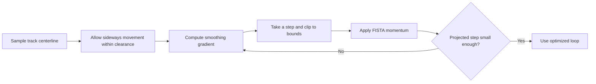
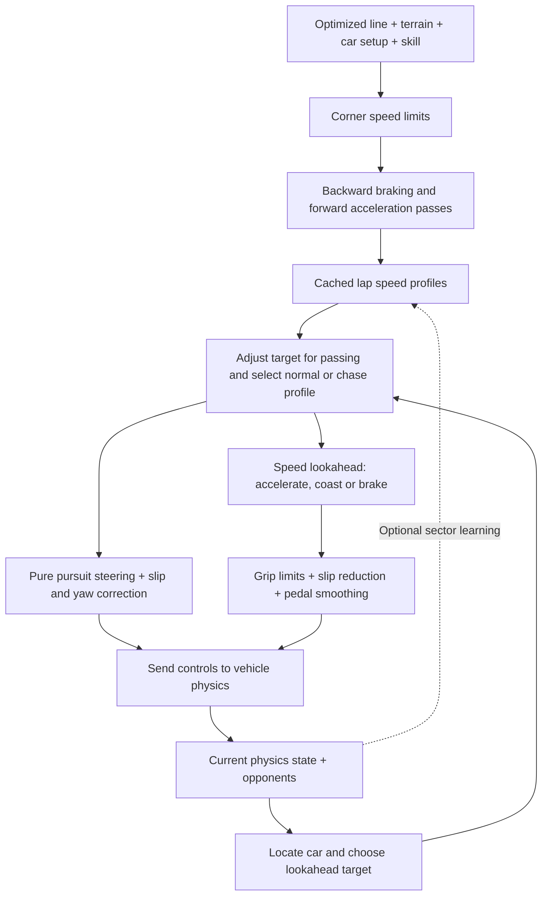
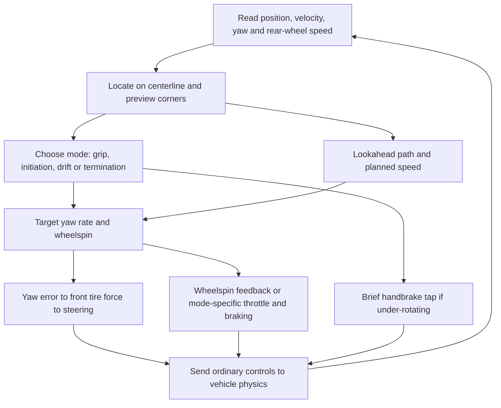

# Bot implementation

Race bots solve two separate problems: **where to drive**, then **how to drive
there**. Sections 1 and 2 cover grip/race bots; section 3 covers the separate
drift controller.

Equations use LaTeX inside `$$` blocks; diagrams use Mermaid. GitHub renders both.
Other Markdown viewers may require extensions or show their source instead.

## 1. Choosing a racing line

### In plain language

Imagine placing beads along the center of the track. Each bead can slide sideways,
but cannot leave a safe corridor inside the road edges. The optimizer moves the
beads to make the resulting loop bend as gently as possible.

This tends to produce wider entries, tighter apexes and wider exits without
explicitly marking those places. A smoother path generally lets a car carry more
speed through a corner.

**FISTA** is the method used to find those bead positions efficiently. Each step
nudges the beads toward a smoother line, clips their movement to the corridor,
and uses momentum from the previous step to accelerate progress. The solver stops
when another ordinary projected step would barely move any bead.

This is a **geometric approximation**, not a guaranteed fastest lap. It does not
jointly optimize the line, tire forces, braking and acceleration. Banking and hills
are considered later when planning speed, not in a full 3D line optimization.
The corridor also bounds sample positions, not the car's entire swept footprint.

### The math

Implementation: [racing-line.ts](../src/racing-line.ts).
The bot's [driving map](../src/race-bot.ts) samples the route approximately every
3 metres. Indices wrap around at the end of the lap.

For each sample:

- $c_i$: fixed centerline position.
- $n_i$: fixed horizontal unit normal, pointing across the track.
- $o_i$: sideways offset being optimized.
- $p_i = c_i + n_i o_i$: resulting line position.
- $m = W/2 - w/2 - e$: maximum offset, using road width $W$, car width $w$
  and the preset's extra edge margin $e$.

The objective is:

$$
\min_{-m \leq o_i \leq m}
f(o) = \frac12 \sum_i
\left\|p_{i-1} - 2p_i + p_{i+1}\right\|^2
$$

The second difference measures how sharply neighboring segments bend. With
evenly spaced samples it is a curvature-like smoothness measure, not exact
geometric curvature. Offsetting the samples changes their spacing, which is one
reason this remains an approximation.

The derivative with respect to one offset is:

$$
[\nabla f(o)]_i =
n_i \cdot
\left(p_{i-2}-4p_{i-1}+6p_i-4p_{i+1}+p_{i+2}\right)
$$

Let $\Pi$ mean clipping every offset to $[-m,m]$. Starting with zero offsets,
$y_0=o_0=0$ and $t_0=1$, each FISTA iteration performs:

$$
o_{k+1} = \Pi\left(y_k-\frac1{16}\nabla f(y_k)\right)
$$

$$
t_{k+1}=\frac{1+\sqrt{1+4t_k^2}}2,
\qquad
y_{k+1}=o_{k+1}
+\frac{t_k-1}{t_{k+1}}(o_{k+1}-o_k)
$$

The second-difference operator has norm at most 4. Its squared objective therefore
has gradient Lipschitz bound 16, giving the conservative step size $1/16$.

Every 25 iterations the solver checks:

$$
\left\|\Pi\left(o_k-\frac1{16}\nabla f(o_k)\right)-o_k\right\|_\infty
\leq 10^{-5}\ \text{metres}
$$

It throws an error if it has not converged within 50,000 iterations.

## 2. Driving along the line

### In plain language

The bot first builds a speed plan for the whole lap. Tight corners require lower
speeds; banking, hills and the selected car setup modify those limits. It then
works backward to leave enough braking distance and forward to avoid assuming
instant acceleration.

During driving, the bot repeatedly:

1. Finds its position along the line.
2. Picks a point ahead, looking farther ahead at higher speeds.
3. Steers an arc toward that point, adding corrections when the car slides or
   rotates too quickly.
4. Checks the speed plan ahead, deciding whether to accelerate, coast or brake.
5. Eases the pedals rather than switching abruptly, and reduces them when sliding.

It drives through the same vehicle physics as the player; it does not move the
car directly or increase the car's physical grip.

Nearby opponents can trigger an inside passing target. Trailing or attacking bots
use a slightly higher effective skill, and attacks can request extra throttle.
These are custom racecraft heuristics, not a collision-free trajectory solver.

Optional learning adjusts pace in roughly 25-metre sectors: back off after
trouble, cautiously increase pace after a clean passage. This is simple feedback,
not a neural network. Learning is disabled by default.

### The math

Implementation: [race-bot.ts](../src/race-bot.ts), with passing targets from
[bot-traffic.ts](../src/bot-traffic.ts).
Speeds are in m/s, distances in metres and angles in radians.
The following describes the core equations; numerical floors are deliberate
heuristic safeguards rather than a complete tire model.

#### Planning speed

Signed horizontal curvature is estimated from the change in segment heading:

$$
\kappa_i \approx
\frac{\operatorname{wrap}(\theta_{\mathrm{out}}-\theta_{\mathrm{in}})}
{(\ell_{\mathrm{in}}+\ell_{\mathrm{out}})/2}
$$

Skill $s$ scales the driver's assumed limits by $q=0.85+0.15s$.
Let $G$ be the preset's cornering limit, $\mu_f,\mu_r$ its front/rear grip
settings, and $b_i$ the signed banking term derived from the terrain normal:

$$
A_i=\max\left(2,\ G\min(\mu_f,\mu_r)q
-\operatorname{sign}(\kappa_i)b_i g\right),
\qquad g=9.81
$$

The change in road grade estimates vertical curvature $\kappa_{v,i}$.
Crests have negative vertical curvature and reduce the estimated tire load:

$$
\lambda_i(v)=\max\left(0.2,\ 1+\frac{v^2\kappa_{v,i}}g\right)
$$

Solving $v^2|\kappa_i|=A_i(1+v^2\kappa_{v,i}/g)$ gives the corner-speed estimate
used by the code:

$$
v_{\mathrm{corner},i}=
\sqrt{\frac{A_i}
{\max\left(|\kappa_i|-A_i\kappa_{v,i}/g,\ 0.0005\right)}}
$$

The initial target is $\min(65,v_{\mathrm{corner},i})$ multiplied by the sector's
pace. Initial pace is $0.9+0.1s$. The load floor above is used in the following
longitudinal calculations; it is not included in that algebraic corner-speed solve.

A friction-circle-inspired factor estimates how much grip remains after turning:

$$
R_i(v)=\lambda_i(v)
\sqrt{\max\left(0.15,\
1-\left[\frac{v^2|\kappa_i|}{A_i\lambda_i(v)}\right]^2\right)}
$$

For sample spacing $\Delta s$ and signed grade $h_i$, the backward and forward
passes use:

$$
d_i=\max(2,\ BqR_{i+1}(v_{i+1})+gh_i),
\qquad
v_i \leftarrow
\min\left(v_i,\sqrt{v_{i+1}^2+2d_i\Delta s}\right)
$$

$$
a_i=\max(1,\ 5R_{i-1}(v_{i-1})-gh_i),
\qquad
v_i \leftarrow
\min\left(v_i,\sqrt{v_{i-1}^2+2a_i\Delta s}\right)
$$

$B$ is the preset's braking limit. Two backward/forward cycles propagate
constraints around the closed lap, including across the start line.
The nonzero floors mean this is not a strict physical friction-circle constraint.

#### Steering

The lookahead distance is $L=5+vT$, where $T$ is the preset's lookahead time.
The bot selects a nearby sample that far ahead. With wheelbase $\ell$, bearing
error $\alpha$, and actual distance $d$ to the target, pure pursuit requests:

$$
\delta_{\mathrm{pursuit}}=
\operatorname{atan2}\left(2\ell\sin\alpha,\ \max(2,d)\right)
$$

At speeds above 5 m/s, body slip $\beta$ and yaw rate $r$ add stabilization:

$$
\delta_{\mathrm{stabilize}}=
0.3\beta+
\operatorname{sign}(\beta)\max(0,|\beta|-\beta_0)
-K_r(r-v\kappa)
$$

$\beta_0$ is the countersteer threshold and $K_r$ the yaw-damping setting.
The combined request is divided by the car's speed-dependent steering limit
and clipped to $[-1,1]$. From a standing start the bot initially holds its heading,
then blends into line-following steering.

#### Throttle, coasting and braking

The bot interpolates its target speed between line samples. For a slower target
$v_j$ at distance $d_j$ ahead, the required deceleration is:

$$
a_{\mathrm{required}}=
\max_j\left(0,\frac{v^2-v_j^2}{2d_j}\right)
$$

The search extends approximately to its estimated coasting stopping distance,
$v^2/(2a_{\mathrm{coast}})$. Small speed reductions initiate coasting early;
larger reductions wait until nearer the braking limit. Separate enter/exit
thresholds prevent rapid toggling.

The desired acceleration begins at
$a_{\mathrm{desired}}=1.5(v_{\mathrm{target}}-v)$.
When slowing, it is capped at $-a_{\mathrm{required}}$.
If braking is not required, the throttle request is:

$$
u_{\mathrm{throttle}}=
\left[
\operatorname{clip}
\left(\frac{a_{\mathrm{desired}}+a_{\mathrm{coast}}}{5},0,1\right)
\right]^2
$$

Squaring compensates for the drivetrain's square-root pedal response.
Braking supplies deceleration beyond coasting, capped using measured cornering
load $vr$ and the estimated grip budget. Brake demand fades between body-slip
magnitudes 0.06 and 0.2 radians; throttle fades between `tractionSlip` and twice
that threshold. Both use smoothstep.

Pedal requests are rate-limited: throttle rises at 4 units/s and falls at 5;
brake changes at 8 units/s. Normal braking waits until throttle has reached zero.
Backward motion and explicit stop targets have immediate braking exceptions.

#### Racecraft and learning

- Chase/attack skill is $\min(1.01,s+0.06)$; the bonuses do not stack.
- Optional attack throttle is $\min(1,1.25u_{\mathrm{throttle}})$, still subject
  to slip reduction and pedal smoothing.
- Inside attacks modify the target bearing by at most 0.22 radians; afterward
  that adjustment decays with a 0.4-second time constant.
- With learning enabled, each eligible completed sector passage updates pace:
  $\operatorname{clip}(p-0.06,0.55,1)$ after trouble, or
  $\operatorname{clip}(p+0.006,0.55,1)$ otherwise, then rebuilds the speed profiles.

## Race references and limitations

- **Beck & Teboulle (2009):**
  [A Fast Iterative Shrinkage-Thresholding Algorithm for Linear Inverse Problems](https://doi.org/10.1137/080716542).
  Reference for FISTA, not a racing-specific objective.
- **Coulter (1992):**
  [Implementation of the Pure Pursuit Path Tracking Algorithm](https://publications.ri.cmu.edu/implementation-of-the-pure-pursuit-path-tracking-algorithm),
  CMU-RI-TR-92-01. Reference for nominal lookahead steering.
- **Heilmeier et al. (2020):**
  [Minimum curvature trajectory planning and control for an autonomous race car](https://doi.org/10.1080/00423114.2019.1631455),
  and [TUM's planner](https://github.com/TUMFTM/global_racetrajectory_optimization).
  Related racing-line research, not a claim that we implement their full method.
- [TUM trajectory planning helpers](https://github.com/TUMFTM/trajectory_planning_helpers):
  documented prior art for forward/backward speed planning.
- [Nav2 Regulated Pure Pursuit](https://docs.ros.org/en/iron/p/nav2_regulated_pure_pursuit_controller/):
  documented navigation prior art for regulated tracking, not our racing policy.

The stabilization, pedal logic, racecraft and sector learning are custom
heuristics. Driver constants are empirically optimized; see
[training-bots.md](training-bots.md). Neither the geometric objective nor clean
headless training results prove minimum lap time or reliable browser driving.

## 3. Drifting through corners

### In plain language

The drift bot wants to **slide through corners while continuing around the track**,
not set a fast lap. It aims its direction of travel toward the track centerline,
even when the nose points somewhere else. It does not follow the optimized
racing line described above.

Think of its controls as two cooperating jobs:

- **Steering manages rotation.** The bot decides how quickly the car should turn,
  compares that with how quickly it is actually turning, and asks the front tires
  for a correction. Countersteering comes out of that calculation; it isn't a
  fixed opposite-lock input.
- **Throttle manages wheelspin.** Once sideways, the bot tries to keep the rear
  tires spinning faster than the car is moving forward. If the wheels spin too
  little it adds throttle; if they spin too much it lifts. It also reduces the
  requested wheelspin when the car is too fast or rotates beyond its target angle.

Before driving, it makes a conservative speed plan: slower for tight corners,
with enough distance to brake beforehand. During driving it repeats this loop:

1. Find the nearest centerline point and look ahead for a corner.
2. Approach at the planned speed, then use throttle to initiate the slide.
   If the car is not rotating enough, briefly tap the handbrake.
3. Once the rear tires are sliding sideways, regulate wheelspin and steer to keep
   the car turning toward the road ahead. An extra rotation correction encourages
   a useful drift angle rather than a shallow slide.
4. When the corner ends, reduce throttle so the rear tires regain grip. If another
   corner appears, return to drifting or initiation as appropriate.

The handbrake tap lasts 0.3 seconds, with at least another 0.3 seconds before a
new tap. Our handbrake also disengages the clutch. A clutch-only kick was tried,
but did not initiate rotation reliably enough, so the bot leaves the separate
clutch control off.

There is no special transition maneuver: changing corner direction changes the
rotation target, and linked transitions emerge from the same controller.
There is also no attacking, aggression, opponent-aware tandem behavior or live
lap-to-lap learning. The offline trainer searches for better driver constants;
that is separate from the bot learning while it drives.

### The math

Implementation: [drift-bot.ts](../src/drift-bot.ts), with driver constants in
[drift-bot-tunings.json](../src/drift-bot-tunings.json).
Distances are metres, speeds m/s, and angles radians unless stated otherwise.
These equations describe the implemented approximation, not a reproduction of
every equation or guarantee in the paper.

#### Measurements and corner speed

Let $v_x,v_y$ be forward and lateral velocity in the car's frame, $v$ its
horizontal speed, $\beta$ its body sideslip angle, and $r$ its yaw rate.
Let $\ell_f,\ell_r$ be the distances from the center of mass to the front and
rear axles, with $\ell=\ell_f+\ell_r$.
The measured rear slip ratio and rear tire slip angle are:

$$
\lambda_r=
\frac{v_{\mathrm{rear\ wheel}}-v_x}{\max(|v_x|,4)},
\qquad
\alpha_r=\operatorname{atan2}(v_y-\ell_r r,\max(v_x,1))
$$

$v_{\mathrm{rear\ wheel}}$ is the mean rear-wheel peripheral speed, not the
engine speed. The denominator floors avoid unstable calculations at low speed.
Body sideslip $\beta$, rear tire slip angle $\alpha_r$ and longitudinal wheel
slip $\lambda_r$ are different measurements.

The centerline headings give a central-difference curvature estimate, averaged
over five neighboring samples. With `driftGrip` $G$ and `brakingLimit` $B$:

$$
v_i=\min\left(45,\sqrt{\frac{G}{\max(|\kappa_i|,10^{-4})}}\right),
\qquad
v_i\leftarrow\min\left(v_i,\sqrt{v_{i+1}^2+2B\Delta s}\right)
$$

Two backward passes propagate braking constraints around the lap. Unlike the
race speed plan, this plan has no forward acceleration pass or explicit
banking/crest correction.

#### Mode selection

A corner is active when the largest absolute centerline curvature within
$v\,\texttt{previewTime}$ ahead exceeds `driftCurvature`. The rear is considered
sliding when $|\alpha_r|>6^\circ$.

| Current mode | Condition                              | Next mode                                   |
| ------------ | -------------------------------------- | ------------------------------------------- |
| Grip         | Corner active and $v>10$               | Initiation                                  |
| Initiation   | Rear sliding                           | Drift                                       |
| Initiation   | No corner active, and rear not sliding | Grip                                        |
| Drift        | No corner active                       | Termination                                 |
| Termination  | Corner active                          | Drift if rear sliding; otherwise initiation |
| Termination  | No corner active and rear not sliding  | Grip                                        |

The initiation sliding test takes precedence over its corner-ended test.
These automatic corner triggers and return paths are game-specific; they do not
exactly reproduce the paper's supervisor.

#### Path and yaw-rate control

The lookahead distance is $d_{\mathrm{look}}=6+vT$, with
$T=\texttt{lookaheadTime}$. Let $d$ be the distance to the chosen centerline
sample and $\eta$ the bearing error relative to the **velocity direction**, not
the nose. Below 1 m/s, heading substitutes for velocity direction.

$$
\kappa_{\mathrm{path}}=
\frac{2\sin\eta}{\max(d,2)},
\qquad
r_{\mathrm{path}}=v_x\kappa_{\mathrm{path}}
$$

This uses the paper's desired-yaw-rate idea, $r_{\mathrm{des}}=v_x/R$, but
supplies curvature with our own pure-pursuit path loop. During initiation and
drift it adds:

$$
r_{\mathrm{des}}=
r_{\mathrm{path}}+
K_\beta(\beta+\sigma\beta_{\mathrm{target}})
$$

$K_\beta=\texttt{angleGain}$, $\beta_{\mathrm{target}}=\texttt{driftAngle}$ and
$\sigma$ is the sign of centerline curvature at the target sample. In our sign
convention the desired body slip is $-\sigma\beta_{\mathrm{target}}$, so the
extra term is zero there. Other modes use $r_{\mathrm{des}}=r_{\mathrm{path}}$.

The controller filters measured lateral acceleration with a 0.05-second
time scale and the finite-difference derivative of $r_{\mathrm{path}}$ with a
0.1-second time scale. Call those $a_y$ and $\dot r_{\mathrm{path,filtered}}$.
Importantly, the derivative is computed **before** adding the angle term.
With mass $m$, yaw inertia $I_z$ and `yawGain` $K_r$, the requested front
axle lateral force is:

$$
F_{yf}=
\operatorname{clip}\left(
\frac{\ell_r m a_y+
I_z[\dot r_{\mathrm{path,filtered}}-K_r(r-r_{\mathrm{des}})]}{\ell},
-0.97F_{\max},0.97F_{\max}
\right)
$$

This follows the paper's yaw-error/front-force structure. The code estimates
front capacity from static axle load:

$$
F_{\max}=\frac{mg\ell_r}{\ell}\,
\texttt{friction}\,\texttt{frontGrip},
\qquad C_f=2\,\texttt{frontStiffness}
$$

It then inverts a saturating tire-force approximation instead of estimating
stiffness online:

$$
\alpha_f=
\frac{F_{\max}}{C_f}\operatorname{atanh}\left(\frac{F_{yf}}{F_{\max}}\right),
\qquad
\delta=\alpha_f+\operatorname{atan2}(v_y+\ell_f r,\max(v_x,1))
$$

The force clamp keeps the inverse finite. Steering is
$\operatorname{clip}(\delta/\delta_{\mathrm{limit}}(v),-1,1)$, using the
car setup's speed-dependent steering limit.

#### Wheelspin and pedals

In drift mode, let $e_v=v-v_i$ and
$h=\operatorname{smoothstep}(|\beta|,
\beta_{\mathrm{target}},\beta_{\mathrm{target}}+0.25)$:

$$
\lambda_{\mathrm{des}}=
\max(0,\lambda_0-K_v\max(0,e_v))(1-h)
$$

$\lambda_0=\texttt{rearSlipRatio}$ and $K_v=\texttt{speedSlipGain}$.
The paper uses a constant target of 0.3; ours is tuned and reduced for overspeed
or excessive angle. A proportional-integral (PI) pedal controller uses
$e_\lambda=\lambda_{\mathrm{des}}-\lambda_r$:

$$
z_{k+1}=\operatorname{clip}(z_k+K_i e_\lambda\Delta t,0,1),
\qquad
u_{\mathrm{throttle}}=\operatorname{clip}(z_{k+1}+K_p e_\lambda,0,1)
$$

$K_p=\texttt{slipGain}$ and $K_i=\texttt{slipIntegral}$.
This is a simpler replacement for the paper's rear-force/torque controller,
not a direct implementation of its equation (9).

- **Initiation, not overspeed:** full throttle, and initialize $z=1$.
- **Termination:** fixed `exitThrottle`.
- **Grip or overspeed initiation:** throttle
  $\operatorname{clip}(-0.5e_v,0,1)$; brake is zero until $e_v>2$, then
  $\operatorname{clip}(0.3(e_v-2),0,1)$. Braking overrides throttle.

A handbrake pulse can start in initiation or drift when $v>10$,
$|\beta|<\texttt{handbrakeSlip}$ and
$\sigma(r_{\mathrm{des}}-r)>0$: the car needs more rotation into the corner.
The pulse timer supplies the 0.3-second hold and cooldown.

### What comes from the paper, and what does not

Source: **Eunhyek Joa, Hyunsoo Cha, Youngjin Hyun, Youngil Koh, Kyongsu Yi and
Jaeyong Park (2020)**,
[A new control approach for automated drifting in consideration of the driving characteristics of an expert human driver](https://www.academia.edu/101650975/A_new_control_approach_for_automated_drifting_in_consideration_of_the_driving_characteristics_of_an_expert_human_driver),
_Control Engineering Practice_, **96**, 104293.
DOI: [10.1016/j.conengprac.2019.104293](https://doi.org/10.1016/j.conengprac.2019.104293).
The comparison here uses the repository's local PDF.

| Paper component                                                                                    | Our implementation                                                                                                                                                       |
| -------------------------------------------------------------------------------------------------- | ------------------------------------------------------------------------------------------------------------------------------------------------------------------------ |
| Supervisor chooses yaw rate and rear longitudinal slip rather than a precomputed drift equilibrium | Adopted as the organizing idea; no drift-equilibrium solver or lookup is required.                                                                                       |
| Desired yaw rate $v_x/R$ (eq. 5)                                                                   | Used as the base request, with custom path tracking and angle correction.                                                                                                |
| Grip, initiation, steady drift and termination modes; nominal rear slip threshold of 6 degrees     | Adapted. Our corner preview replaces manual initiation and yaw-error gating; our state machine also permits returning to initiation or drift before fully straightening. |
| Track yaw error through front lateral force (eqs. 12–14)                                           | Adapted to our coordinates, filters, force limits and nonlinear tire-model inversion.                                                                                    |
| Regulate excessive rear longitudinal slip (eq. 6 and section 4.2.1)                                | Adopted goal, but implemented with a bounded PI throttle loop rather than the paper's force/torque law.                                                                  |
| Full-throttle initiation and reduced-throttle termination                                          | Adapted, with speed protection and handbrake-assisted initiation.                                                                                                        |
| Online recursive least-squares estimation of front lateral and rear longitudinal tire stiffness    | Not implemented. Front stiffness comes from the car setup; there is no online rear stiffness estimator.                                                                  |
| Rear torque feedforward, wheel-dynamics compensation and gas-pedal/engine-torque lookup            | Not reproduced by the bot. It sends pedal inputs through the game's existing drivetrain.                                                                                 |
| Stability proof, region-of-attraction analysis and real-vehicle dry/wet-road experiments           | Not reproduced. Those results do not establish stability or real-world validity of our modified controller.                                                              |
| Drift path tracking                                                                                | The paper leaves this for future work. Centerline pursuit, speed planning and angle targeting are our additions.                                                         |

The paper is motivated by measurements and analysis of an expert driver, not by
copying a recorded lap. Likewise, our controller is not trained to imitate the
player's drift recording.

### Offline training and limits

[drift-training.ts](../src/drift-training.ts) measures useful corner-drift
distance, mean angle, linked transitions, dirt contact, yaw error and steering
effort. The [offline optimizer](../scripts/optimize-drift-bot.mjs) searches driver
constants on Hillside Circuit and Sweeper Loop; see
[training-bots.md](training-bots.md) for commands and output.

A scored drift needs body slip above 15 degrees, speed above 10 m/s, and
centerline curvature above $1/150$ within 20 metres ahead or behind. This
15-degree **scoring** threshold differs from the supervisor's 6-degree **rear
tire slip** threshold. The score rewards coverage and mean angle near 35 degrees,
plus side changes linked across gaps shorter than 0.6 seconds. These are custom
style goals, not an objective function taken from the paper.

Crossing a white line with the body is not a scoring failure. Dirt penalties
come from actual tire contact with unpaved ground, not the body bounding box.
Every dirt-contact step is penalized; more than 2 continuous seconds ends a
run. Spins, getting stuck and timeouts also fail a run. The controller's separate
footprint-based off-track metric is diagnostic, not a hard road-edge constraint.

Clean training laps demonstrate behavior in this simulation, not guaranteed
track containment, spin avoidance or optimal style. In particular, there is no
predictive swept-footprint safety solver, dedicated spin-recovery mode or tandem
planner, and the simplified force estimate does not reproduce every load change
in the full vehicle physics.
